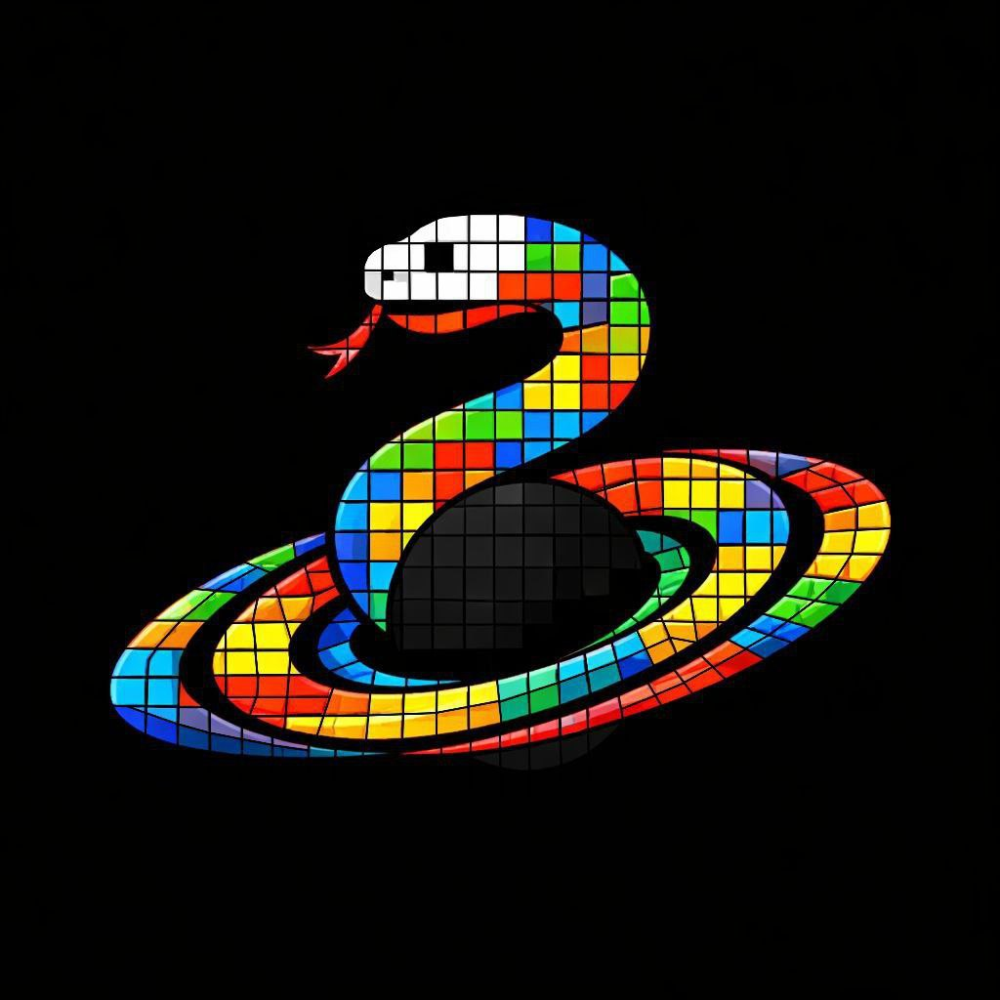
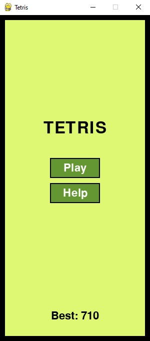
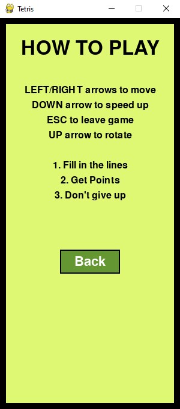
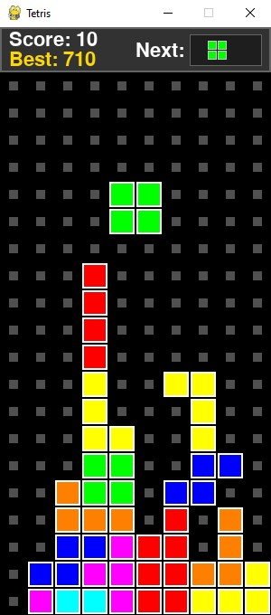

# Tetris

> Classic Tetris in NESTIMS style.

| Project Information | Details |
|---|---|
| Project ID | NS-007 |
| Direction | Games |
| Development Phase | Phase I |
| Version | v2.0 |
| Platform | Windows / Python |
| Status | Completed |

> 

## 📖 Overview

A classic falling-block puzzle game with an updated Python implementation, line clearing and persistent records.

## ✨ Features

- Seven-bag piece generation

- Piece rotation and next-piece preview

- Line clearing and score tracking

- Persistent local best score

- Pause and restart controls

## 🛠 Technology Stack

- Python
- Pygame
- JSON

## 📦 Installation

- Download the Windows executable from Releases: [more...](https://github.com/NebulaStack-prog/Tetris/releases/tag/v2.0)

- Or run with Python latest version of code: [more...](Tetris-New.py)

- Original source code (Old): [more...](Tetris.py)

## 📄 Documentation (For old code)

- Russian documentation: [more...](Tetris_RU.md)

- English documentation: [more...](Tetris_EN.md)

## 📊 Project Status

A completed NESTIMS Phase I project. Both the original and updated Python implementations are preserved.

## 📷 Screenshots

© NESTIMS
